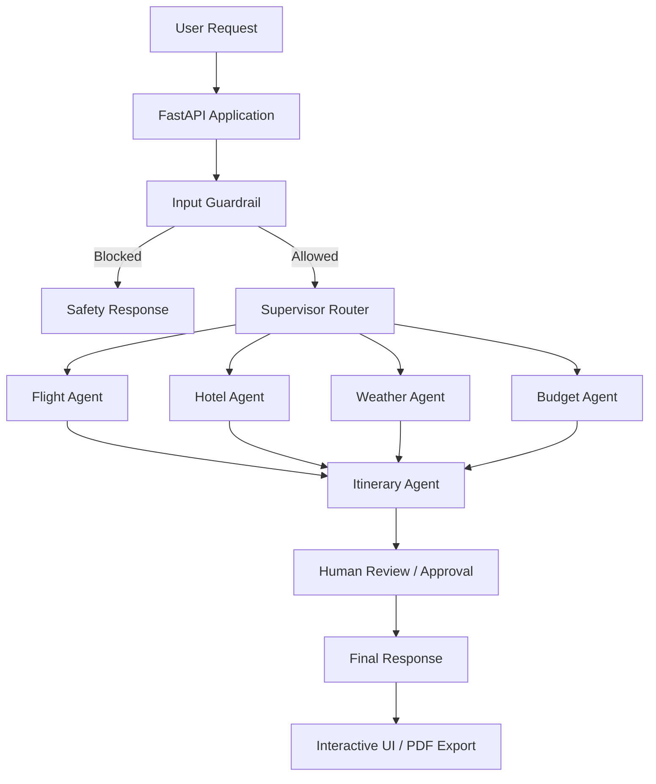
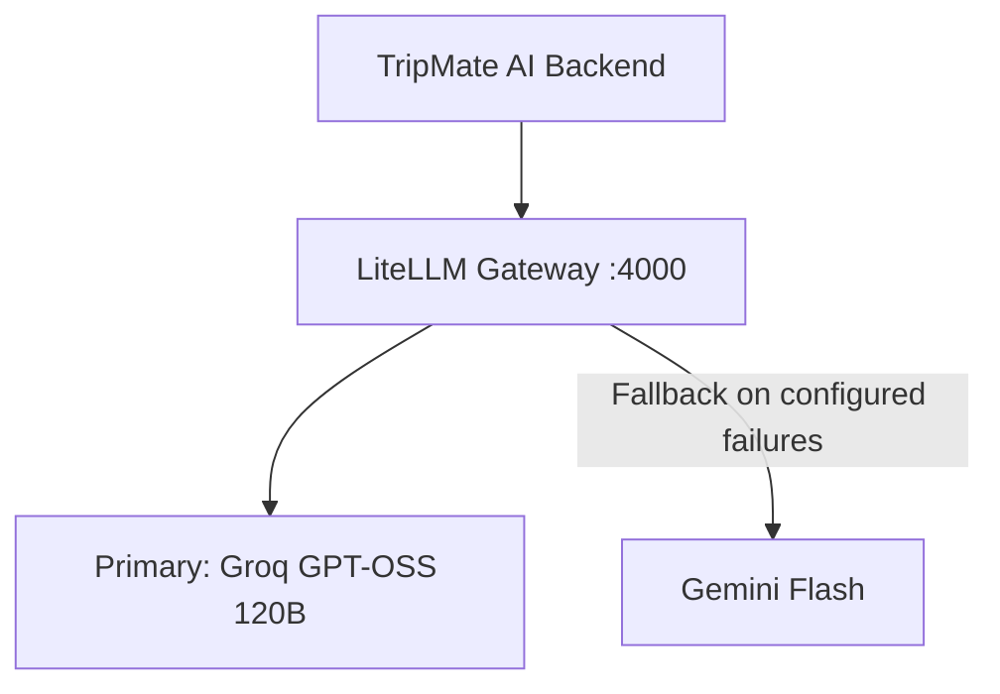

# ✈️ TripMate AI — Multi-Agent Travel Planner

TripMate AI is an AI-powered travel planning application built with **FastAPI, LangGraph, LiteLLM, PostgreSQL, and the Model Context Protocol (MCP)**. It orchestrates specialized agents to help users plan trips based on their destination, duration, budget, and travel preferences.

The system combines intent-based agent routing, input guardrails, external travel information tools, budget analysis, and itinerary generation through a stateful multi-agent workflow.

## 🌟 Key Features

- **🤖 Multi-Agent Orchestration:** Uses LangGraph to coordinate specialized Flight, Hotel, Weather, Budget, and Itinerary agents.
- **🧭 Supervisor Routing:** Selects relevant agents based on the user's travel request.
- **🛡️ Input Guardrails:** Identifies and blocks off-topic requests before travel-specific processing.
- **🔀 LLM Gateway with Fallback:** Uses LiteLLM to provide a unified OpenAI-compatible interface to the primary Groq model and a Gemini fallback model.
- **✈️ Flight Search:** Integrates AviationStack through an MCP-based workflow and a dedicated flight-provider abstraction.
- **🌦️ Weather Information:** Retrieves weather conditions and forecasts through the weather MCP integration.
- **🔎 Travel Research:** Uses Tavily for web research, accommodation discovery, neighborhood information, and attractions.
- **💰 Budget Analysis:** Evaluates trip costs, budget feasibility, and potential savings.
- **👤 Human-in-the-Loop:** Supports itinerary review and revision through LangGraph workflow interruptions where configured.
- **🗃️ Persistent Workflow State:** Uses PostgreSQL-backed LangGraph checkpointing to support stateful conversations.
- **🎨 Interactive Web Interface:** Provides natural-language and guided-form travel inputs, agent execution feedback, itinerary rendering, and PDF export.
- **🧪 Automated Evaluation:** Measures routing, guardrail decisions, destination extraction, response existence, and flight-search behavior.
- **📊 JSON Evaluation Reports:** Saves machine-readable evaluation summaries and timestamped run reports.
- **✅ Automated Tests:** Includes tests for evaluation logic, flight-provider behavior, and supervisor routing.

---

## 🏗️ System Architecture

### Application workflow



### LLM gateway

TripMate AI uses LiteLLM as a unified model gateway, separating application-level LLM calls from provider-specific APIs.



- The backend communicates with the gateway through an OpenAI-compatible API.
- The gateway configuration defines the primary and fallback models.
- Provider credentials are loaded through environment variables.
- The fallback behavior depends on the configured LiteLLM model and retry settings.

### External integrations

| Integration | Purpose |
|---|---|
| AviationStack | Flight schedule information |
| Tavily | Web search and travel research |
| OpenWeather | Weather information and forecasts |
| PostgreSQL | Persistent LangGraph workflow state |
| LangSmith (optional) | LLM workflow tracing and observability |

---

## 🧪 Evaluation Framework

TripMate AI includes a reproducible evaluation runner and a test suite to validate important workflow behavior.

### Current baseline

The current evaluation dataset contains **5 test cases** covering:

- Travel planning with a budget
- Destination and duration extraction
- Flight-search routing
- Weather-related routing
- Off-topic request blocking

The latest recorded baseline reports:

| Metric | Result |
|---|---:|
| Evaluation cases passed | 5/5 |
| Pass rate | 100% |
| Guardrail accuracy | 5/5 |
| Destination accuracy | 5/5 |
| Agent-selection accuracy | 5/5 |
| Response-existence score | 5/5 |
| Flight-search score | 1/1 |
| Total LLM calls | 14 |
| Real AviationStack requests during evaluation | 0 |

**Important:** These results apply only to the current five-case dataset. They do not establish overall production accuracy. Review the response-existence evaluator and its report field for consistency before relying on that metric.

### Mock versus production flight search

The evaluation runner uses a deterministic mock flight provider, avoiding real AviationStack requests for flight evaluation cases. Normal application execution uses the configured AviationStack provider.

Mock results are test fixtures only and must not be used for real travel or booking decisions. Evaluation still exercises the configured LLM and may require other external services and credentials.

### Run evaluation

From the repository root on Windows:

```powershell
.\.venv\Scripts\python.exe -m evaluation.run_eval
```

The runner writes reports to:

```text
evaluation/
├── dataset.py
├── evaluators.py
├── run_eval.py
└── reports/
    ├── latest_report.json
    └── run_<timestamp>.json
```

Inspect the latest summary:

```powershell
.\.venv\Scripts\python.exe -c "import json; r=json.load(open('evaluation/reports/latest_report.json', encoding='utf-8')); print(json.dumps(r['summary'], indent=2))"
```

### Run automated tests

```powershell
.\.venv\Scripts\python.exe -m unittest discover -s tests
```

---

## 📁 Project Structure

```text
TripMate-AI-Final/
├── app.py
├── backend.py
├── flight_provider.py
├── mcp_client.py
├── weather_mcp_server.py
├── litellm_config.yaml
├── requirements.txt
├── Dockerfile
├── .dockerignore
├── .gitignore
├── .env.example
├── evaluation/
│   ├── __init__.py
│   ├── dataset.py
│   ├── evaluators.py
│   ├── run_eval.py
│   └── reports/
├── tests/
│   ├── test_evaluation.py
│   ├── test_flight_provider.py
│   └── test_supervisor_routing.py
├── static/
│   ├── style.css
│   └── script.js
└── templates/
    └── index.html
```

- `app.py` — FastAPI application and HTTP endpoints.
- `backend.py` — LangGraph state, agent nodes, routing, and workflow execution.
- `flight_provider.py` — Production AviationStack adapter and deterministic evaluation provider.
- `mcp_client.py` — MCP client configuration and external-tool integration.
- `litellm_config.yaml` — LLM gateway model and fallback configuration.
- `evaluation/` — Test dataset, evaluators, runner, and JSON reports.
- `tests/` — Automated unit tests.
- `static/` and `templates/` — Frontend assets and HTML template.

---

## ⚙️ Prerequisites

- Python version compatible with the project's dependencies
- PostgreSQL database accessible to the application
- LiteLLM installed in the active Python environment
- API credentials for the providers you intend to use:
  - [Groq](https://console.groq.com/)
  - [Google AI Studio](https://aistudio.google.com/) for Gemini
  - [AviationStack](https://aviationstack.com/)
  - [Tavily](https://tavily.com/)
  - [OpenWeather](https://openweathermap.org/)
  - [LangSmith](https://smith.langchain.com/) (optional)

Check the project's dependency and Python-version requirements before installing.

---

## 🚀 Run Locally on Windows

### 1. Clone the repository

```powershell
git clone https://github.com/nitesh45176/TripMate-AI-Final.git
cd TripMate-AI-Final
```

### 2. Create and activate a virtual environment

```powershell
python -m venv .venv
.\.venv\Scripts\Activate.ps1
```

If the repository already has a working `.venv`, activate that environment instead of recreating it.

### 3. Install dependencies

```powershell
python -m pip install -r requirements.txt
```

Ensure the environment also contains LiteLLM if it is not installed by the project's requirements.

### 4. Configure environment variables

Create a `.env` file using `.env.example` as a template. Fill in the credentials locally; **never commit `.env` or real API keys to GitHub**.

Example configuration structure:

```env
GROQ_API_KEY=your_groq_api_key
GEMINI_API_KEY=your_gemini_api_key
LITELLM_MASTER_KEY=your_litellm_master_key

AVIATIONSTACK_API_KEY=your_aviationstack_api_key
TAVILY_API_KEY=your_tavily_api_key
OPENWEATHER_API_KEY=your_openweather_api_key

DATABASE_URL=your_postgresql_connection_string
DEFAULT_ORIGIN_IATA=your_default_origin_iata

TRIPMATE_EVAL_MODE=false

LANGSMITH_TRACING=false
LANGSMITH_API_KEY=your_langsmith_api_key
LANGSMITH_PROJECT=TripMate-AI
```

Use the exact variable names expected by the application and LiteLLM configuration. Configure the gateway process so it receives the required model credentials and master key.

### 5. Start the LiteLLM gateway

Open a separate terminal in the repository root and activate the same virtual environment:

```powershell
.\.venv\Scripts\Activate.ps1
litellm --config litellm_config.yaml --port 4000
```

Keep this terminal running. Confirm the gateway starts successfully and that its configured models and credentials are available.

### 6. Start the FastAPI application

Open another terminal, activate the environment, and run:

```powershell
python -m uvicorn app:app --host 127.0.0.1 --port 8000 --reload
```

Alternatively, use `python app.py` if that entry point is configured for local startup.

### 7. Open the frontend

Navigate to:

**http://127.0.0.1:8000**

Submit a travel query and check the backend and gateway terminal logs if a request fails.

---

## 📦 Deployment

The application can be containerized using the included Dockerfile, provided the image includes all required dependencies and runtime configuration.

```powershell
docker build -t tripmate-ai .
```

Before deploying, verify the following:

- The production server binds to `0.0.0.0` and the platform-provided port.
- Required environment variables are configured through the hosting platform's secret manager.
- PostgreSQL is reachable from the deployed service.
- The LiteLLM gateway and its model credentials are available to the backend.
- MCP servers and their external APIs are reachable in the deployment environment.
- Secrets and local evaluation artifacts are not accidentally exposed.

A separate LiteLLM service may be required if the application container does not start the gateway itself. Confirm the deployment topology before using a production start command.

---

## 🔐 Security Notes

- Never commit `.env` files, API keys, passwords, or database connection credentials.
- Use `.env.example` only for placeholder values.
- Restrict access to the LiteLLM gateway and protect its master key.
- Review evaluation reports before publishing them, especially if they contain user queries or error details.
- Treat mock flight data as test-only information.

---

## 📜 License

Distributed under the MIT License. See the `LICENSE` file for details.

---

## 👥 Credits and Acknowledgments

- **LangGraph and LangChain** — stateful agent workflows and LLM integration.
- **LiteLLM** — unified model gateway and configured fallback support.
- **Groq** — primary LLM inference provider.
- **Google Gemini** — configured fallback model.
- **FastAPI** — backend API framework.
- **FastMCP and MCP integrations** — access to external travel tools.
- **PostgreSQL** — persistent workflow state.
- **LangSmith** — optional tracing and observability.
